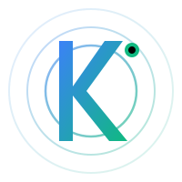

<p align="center">
  
</p>

<h1 align="center">⚡ KeeLead</h1>

<p align="center">
  <strong>Find leads. Verify emails. Research companies. Close deals.</strong>
</p>

<p align="center">
  A free, open-source, self-hosted lead generation platform powered by AI with 62 data sources.
</p>

<p align="center">
  <a href="#-features">Features</a> •
  <a href="#-quick-start">Quick Start</a> •
  <a href="#-data-sources">Data Sources</a> •
  <a href="#-configuration">Configuration</a> •
  <a href="#-api-keys-guide">API Keys Guide</a> •
  <a href="#-docker">Docker</a> •
  <a href="#-architecture">Architecture</a> •
  <a href="#-contributing">Contributing</a>
</p>

---

## 🆓 Why KeeLead?

| Problem | KeeLead Solution |
|---------|-----------------|
| 💰 ZoomInfo costs $15K+/yr, Apollo $49-149/mo | **100% Free** — MIT licensed, use forever |
| 🔒 Closed source, vendor lock-in | **Open source** — full code, modify anything |
| 🚫 Rate limits, artificial caps | **Self-hosted** — your data, your limits |
| 🤷 No AI integration | **AI-native** — MCP server, function calling |
| 📊 Need 5+ tools for lead gen | **All-in-one** — 62 sources in one tool |

---

## ✨ Features

### 🔍 62 Data Sources
- **35 FREE sources** — No API key required, works out of the box!
- **27 premium sources** — Optional API keys for enhanced data
- Categories: Search, Professional, Company, Local Business, Social Media, Developer, Startup, Government, Education, Email, Events

### 💬 AI Chat Interface
- ChatGPT/Claude-style natural language interface
- Ask: *"Find me 50 SaaS founders in San Francisco"*
- Multi-provider: OpenAI, Claude, Ollama, Groq, Mistral, NVIDIA, OpenRouter
- Streaming responses with markdown, tables, and code blocks

### 📧 10-Layer Email Verification
- Syntax validation (RFC 5322)
- Domain existence & MX record verification
- Disposable email detection (10K+ domain blocklist)
- SMTP verification, catch-all detection, spam trap detection
- Score 0-100 with detailed breakdown

### 🗺️ OpenStreetMap Local Business Search
- **FREE worldwide coverage** — no API key needed!
- Search: "restaurants in London", "dentists in Tokyo", "plumbers near Berlin"
- 40+ business type mappings
- Extracts: names, phones, emails, addresses, hours

### 🤖 Browser Automation
- Playwright-powered headless browser
- Scrape JavaScript-heavy sites
- Form filling, screenshots, infinite scroll
- Utility functions for tables, lists, cards

### 📊 Dashboard & Management
- 15+ pages with full dark theme
- Lead management with AI scoring (0-100)
- Kanban pipeline board
- Campaign management with drip sequences
- Analytics & reporting
- Export in 7 formats (CSV, JSON, Excel, vCard, PDF, XML, YAML)

### 🛡️ Compliance
- GDPR tools, CAN-SPAM compliance
- Do-Not-Contact list management
- Audit logs, consent management

---

## 🚀 Quick Start

```bash
# Clone the repository
git clone https://github.com/Atum246/keelead.git
cd keelead

# Install dependencies
npm install

# Set up database
npx prisma db push

# Seed with demo data (optional)
npx tsx prisma/seed.ts

# Start development server
npm run dev
```

Open [http://localhost:3000](http://localhost:3000) 🎉

### What Works Immediately (No API Keys!)
- ✅ 35 free data sources (OpenStreetMap, SEC EDGAR, GitHub, Reddit, etc.)
- ✅ Email verification (DNS, MX, SMTP checks)
- ✅ Full dashboard & lead management
- ✅ Export in 7 formats
- ✅ Compliance tools

### What Needs API Keys
- 🤖 AI chat (at least one provider needed)
- 🔍 Premium search (Google, Bing, Brave)
- 📱 Social media (Twitter, Instagram, etc.)
- 💼 Premium data (Crunchbase, Hunter.io, etc.)

---

## 📦 Data Sources (62 Total)

### ✅ FREE Sources (35) — No API Key Required

#### 🔍 Search (2)
| Source | API | Description |
|--------|-----|-------------|
| DuckDuckGo | `api.duckduckgo.com` | Instant Answer API, company info |
| SearXNG | 7 public instances | Meta search (Google + Bing + DuckDuckGo) |

#### 💼 Professional (1)
| Source | API | Description |
|--------|-----|-------------|
| LinkedIn | Google search proxy | Profile discovery via search engines |

#### 🏢 Company (4)
| Source | API | Description |
|--------|-----|-------------|
| SEC EDGAR | `efts.sec.gov` | US public company filings, officers |
| OpenCorporates | `api.opencorporates.com` | 140+ country company registries |
| Companies House | UK gov API | UK company registry |
| Builtin | Scraping | Tech company directory |

#### 📍 Local Business (4)
| Source | API | Description |
|--------|-----|-------------|
| **OpenStreetMap** | `overpass-api.de` | **FREE worldwide business data!** |
| Yellow Pages | Scraping | US business directory |
| BBB | Scraping | Business ratings & reviews |
| Chamber of Commerce | Scraping | Local business directories |

#### 📱 Social (2)
| Source | API | Description |
|--------|-----|-------------|
| GitHub | `api.github.com` | Developer profiles (60 req/hr free) |
| Reddit | `reddit.com/search.json` | User profiles & communities |

#### 👨‍💻 Developer (5)
| Source | API | Description |
|--------|-----|-------------|
| NPM | `registry.npmjs.org` | Package authors & maintainers |
| PyPI | `pypi.org/pypi` | Python package authors |
| Docker Hub | `hub.docker.com/v2` | Container image publishers |
| Dev.to | `dev.to/api` | Developer community profiles |
| Stack Overflow | `api.stackexchange.com` | Developer Q&A profiles |
| GitHub Orgs | `api.github.com` | Company organizations |

#### 🚀 Startup (2)
| Source | API | Description |
|--------|-----|-------------|
| Indie Hackers | Scraping | Indie founder profiles |
| Beta List | Scraping | Startup directory |

#### 🏛️ Government (6)
| Source | API | Description |
|--------|-----|-------------|
| USASpending | `api.usaspending.gov` | Federal contractors & spending |
| US Census | `api.census.gov` | Business patterns by industry |
| EU Register | Scraping | EU transparency register |
| SAM.gov | US gov API | Government contractors |
| USPTO Patents | `api.patentsview.org` | Patent inventors & holders |
| USPTO Trademarks | `developer.uspto.gov` | Trademark owners |

#### 🎓 Education (4)
| Source | API | Description |
|--------|-----|-------------|
| Google Scholar | Scraping | Academic researchers & papers |
| ResearchGate | Scraping | Researcher profiles |
| ORCID | `pub.orcid.org` | Researcher IDs & affiliations |
| Academia.edu | Scraping | Academic profiles |

#### 📧 Email/Domain (3)
| Source | API | Description |
|--------|-----|-------------|
| DNS Lookup | `dns.google/resolve` | MX records, email provider detection |
| SSL Certificate | `crt.sh` | Certificate Transparency logs |
| WHOIS | `rdap.org` | Domain registration data |

#### 🎤 Events (1)
| Source | API | Description |
|--------|-----|-------------|
| Conference Speakers | PaperCall + Sessionize | Speaker profiles & talks |

---

### 💰 Premium Sources (27) — API Keys Required

#### 🔍 Search (3)
| Source | Free Tier | Get Key |
|--------|-----------|---------|
| Google Custom Search | 100/day | [Google Cloud Console](https://console.cloud.google.com/apis/api/customsearch.googleapis.com) |
| Bing Web Search | 1,000/month | [Azure Portal](https://portal.azure.com) |
| Brave Search | 2,000/month | [Brave Search API](https://api.search.brave.com) |

#### 📱 Social Media (7)
| Source | Free Tier | Get Key |
|--------|-----------|---------|
| Twitter/X | Very limited | [Developer Portal](https://developer.twitter.com) |
| Instagram | Requires app review | [Meta for Developers](https://developers.facebook.com) |
| Facebook | Requires app review | [Meta for Developers](https://developers.facebook.com) |
| TikTok | Requires approval | [TikTok for Developers](https://developers.tiktok.com) |
| YouTube | 10,000 units/day | [Google Cloud Console](https://console.cloud.google.com) |
| Pinterest | Requires approval | [Pinterest Developers](https://developers.pinterest.com) |

#### 💼 Professional (3)
| Source | Free Tier | Get Key |
|--------|-----------|---------|
| Crunchbase | Limited | [Crunchbase API](https://data.crunchbase.com) |
| AngelList | Restricted | [Wellfound API](https://wellfound.com) |
| Xing | Partner only | [Xing Developer](https://developer.xing.com) |

#### 🏢 Company (3)
| Source | Free Tier | Get Key |
|--------|-----------|---------|
| Glassdoor | No public API | N/A |
| Indeed | No public API | N/A |
| G2 | No public API | N/A |

#### 📍 Local Business (5)
| Source | Free Tier | Get Key |
|--------|-----------|---------|
| Google Maps | $200/month credit | [Google Cloud Console](https://console.cloud.google.com/apis/api/maps-backend) |
| Yelp | 5,000/day | [Yelp Fusion](https://fusion.yelp.com) |
| Foursquare | 100K free | [Foursquare Developer](https://developer.foursquare.com) |
| Thumbtack | No public API | N/A |
| HomeAdvisor | No public API | N/A |

#### 📧 Email (2)
| Source | Free Tier | Get Key |
|--------|-----------|---------|
| Hunter.io | 25/month | [Hunter.io](https://hunter.io) |
| Clearbit | Limited | [Clearbit](https://clearbit.com) |

#### 🚀 Startup (3)
| Source | Free Tier | Get Key |
|--------|-----------|---------|
| Product Hunt | GraphQL API | [Product Hunt API](https://api.producthunt.com/v2/docs) |
| F6S | API available | [F6S API](https://f6s.com) |
| Gust | Partner access | [Gust API](https://gust.com) |

#### 🎤 Events (3)
| Source | Free Tier | Get Key |
|--------|-----------|---------|
| Eventbrite | Free tier | [Eventbrite API](https://www.eventbrite.com/platform/api) |
| Meetup | GraphQL API | [Meetup API](https://www.meetup.com/api/schema) |
| Luma | API available | [Luma API](https://lu.ma) |

---

## ⚙️ Configuration

### Environment Variables

Copy `.env.example` to `.env` and configure:

```bash
cp .env.example .env
```

### 🤖 AI Providers (At Least One Required for Chat)

```env
# OpenAI — Best overall quality
OPENAI_API_KEY=sk-...

# Anthropic Claude — Great for analysis
ANTHROPIC_API_KEY=sk-ant-...

# OpenRouter — Access to ALL models with one key
OPENROUTER_API_KEY=sk-or-...

# Ollama — FREE local AI (no API key!)
OLLAMA_BASE_URL=http://localhost:11434

# NVIDIA NIM — Free tier available
NVIDIA_API_KEY=nvapi-...

# Groq — Ultra-fast inference
GROQ_API_KEY=gsk_...

# Mistral — European AI
MISTRAL_API_KEY=...
```

### 🔍 Search APIs (Optional — Enhances Search Results)

```env
GOOGLE_SEARCH_API_KEY=...
GOOGLE_SEARCH_CX=...
BING_SEARCH_API_KEY=...
BRAVE_SEARCH_API_KEY=...
```

### 📧 Email & Data Enrichment (Optional)

```env
HUNTER_API_KEY=...
CLEARBIT_API_KEY=...
```

### 🔔 Notifications (Optional)

```env
SLACK_WEBHOOK_URL=...
DISCORD_WEBHOOK_URL=...
```

---

## 🔑 API Keys Guide

### Tier 1: Start Here (Free & Essential)

1. **Ollama** (FREE local AI)
   ```bash
   # Install Ollama
   curl -fsSL https://ollama.ai/install.sh | sh
   # Pull a model
   ollama pull llama3.1
   # KeeLead auto-detects it at http://localhost:11434
   ```

2. **OpenRouter** (Access to 100+ models, pay-as-you-go)
   - Go to [openrouter.ai](https://openrouter.ai)
   - Create account → Get API key
   - Add to `.env`: `OPENROUTER_API_KEY=sk-or-...`

### Tier 2: Enhance Search (Optional)

3. **Google Custom Search** (100 free/day)
   - Go to [console.cloud.google.com](https://console.cloud.google.com)
   - Enable "Custom Search API"
   - Create API key
   - Go to [programmablesearchengine.google.com](https://programmablesearchengine.google.com)
   - Create a search engine, get the CX ID
   - Add both to `.env`

4. **Brave Search** (2,000 free/month)
   - Go to [api.search.brave.com](https://api.search.brave.com)
   - Create account → Get API key
   - Add to `.env`: `BRAVE_SEARCH_API_KEY=...`

### Tier 3: Premium Data (Optional)

5. **Hunter.io** (25 free/month)
   - Go to [hunter.io](https://hunter.io)
   - Create account → Get API key
   - Add to `.env`: `HUNTER_API_KEY=...`

6. **Yelp Fusion** (5,000 free/day)
   - Go to [fusion.yelp.com](https://fusion.yelp.com)
   - Create app → Get API key
   - Add to `.env`: `YELP_API_KEY=...`

7. **Google Maps** ($200 free credit/month)
   - Go to [console.cloud.google.com](https://console.cloud.google.com)
   - Enable "Places API"
   - Create API key
   - Add to `.env`: `GOOGLE_MAPS_API_KEY=...`

---

## 🐳 Docker

### Quick Start
```bash
docker-compose up -d
```

### Manual Build
```bash
docker build -t keelead .
docker run -p 3000:3000 keelead
```

### With Environment Variables
```bash
docker run -p 3000:3000 \
  -e OPENAI_API_KEY=sk-... \
  -e DATABASE_URL=file:./prisma/keelead.db \
  keelead
```

---

## 🏗️ Architecture

```
keelead/
├── app/                    # Next.js App Router
│   ├── api/               # API routes
│   │   ├── chat/          # AI chat endpoint
│   │   ├── leads/         # Lead CRUD
│   │   ├── verify/        # Email verification
│   │   ├── sources/       # Data source management
│   │   ├── export/        # Export endpoints
│   │   └── ...
│   ├── chat/              # Chat UI
│   └── dashboard/         # Dashboard pages
├── lib/
│   ├── sources/           # 62 data source plugins
│   │   ├── search/        # Search engines
│   │   ├── professional/  # LinkedIn, Crunchbase, etc.
│   │   ├── company/       # SEC EDGAR, OpenCorporates, etc.
│   │   ├── local/         # OpenStreetMap, Yelp, etc.
│   │   ├── social/        # GitHub, Reddit, etc.
│   │   ├── developer/     # NPM, PyPI, Stack Overflow, etc.
│   │   ├── startup/       # Indie Hackers, Beta List, etc.
│   │   ├── government/    # USASpending, Census, Patents, etc.
│   │   ├── education/     # Google Scholar, ORCID, etc.
│   │   ├── email/         # DNS, WHOIS, SSL, etc.
│   │   ├── events/        # Conference speakers, etc.
│   │   ├── base.ts        # Base source class
│   │   ├── types.ts       # Type definitions
│   │   └── index.ts       # Source manager
│   ├── browser/           # Playwright browser automation
│   │   ├── index.ts       # BrowserAutomation class
│   │   └── scraping-utils.ts
│   ├── ai/                # AI provider abstraction
│   ├── agent/             # AI agent & function calling
│   ├── email/             # Email verification engine
│   └── ...
├── prisma/                # Database schema
├── mcp/                   # MCP server
├── cli/                   # CLI tool
└── components/            # React components
```

### Tech Stack
- **Frontend**: Next.js 14, React, TypeScript, Tailwind CSS
- **Backend**: Next.js API Routes, Prisma ORM
- **Database**: SQLite (easily switch to PostgreSQL)
- **AI**: Multi-provider (OpenAI, Claude, Ollama, Groq, etc.)
- **Browser**: Playwright for automation
- **License**: MIT

---

## 🤖 AI Agent Integration

### MCP Server
KeeLead includes a built-in MCP (Model Context Protocol) server for AI agent integration.

```bash
# Start MCP server
npm run mcp
```

### Function Calling
AI agents can use these tools:
- `keelead_search_leads` — Search across 62 data sources
- `keelead_verify_email` — 10-layer email verification
- `keelead_research_company` — Deep company research
- `keelead_find_contact` — Find contact information
- `keelead_enrich_lead` — Enrich lead data
- `keelead_get_signals` — Get intent signals (job changes, hiring, funding, news)
- `keelead_score_lead` — AI lead scoring (0-100) based on ICP fit
- `keelead_export_leads` — Export leads to CSV, JSON, Excel, vCard, or PDF

---

## 📤 Export Formats

Export leads in 7 formats:
- **CSV** — Spreadsheet compatible
- **JSON** — Developer-friendly
- **Excel (XLSX)** — Microsoft Excel
- **vCard** — Contact import
- **PDF** — Reports & presentations
- **XML** — Enterprise integration
- **YAML** — Configuration-friendly

---

## 🛡️ Security

- All API keys stored encrypted
- Self-hosted — your data never leaves your server
- No telemetry or tracking
- GDPR & CAN-SPAM compliant tools
- Audit logging for all actions

---

## 🗺️ Roadmap

### v2.0 ✅ (Current)
- [x] 62 data sources (35 free + 27 premium)
- [x] AI chat interface with multi-provider support
- [x] 10-layer email verification
- [x] OpenStreetMap local business search
- [x] Browser automation with Playwright
- [x] Dashboard with 15+ pages
- [x] Campaign management
- [x] Pipeline (Kanban)
- [x] Export in 7 formats
- [x] Compliance tools

### v2.1 (Next)
- [ ] Browser extension (Chrome/Firefox)
- [ ] Real-time collaboration
- [ ] Voice interface (speech-to-text)
- [ ] Mobile app (React Native)
- [ ] CRM integrations (HubSpot, Salesforce)
- [ ] Webhook triggers
- [ ] Plugin marketplace

---

## 🤝 Contributing

We welcome contributions! See [CONTRIBUTING.md](CONTRIBUTING.md) for guidelines.

### Adding a New Data Source
1. Create a file in `lib/sources/{category}/your-source.ts`
2. Extend `BaseSource` class
3. Implement `search()`, optionally `getCompany()` and `getContact()`
4. Register in `lib/sources/index.ts`
5. Submit a PR!

---

## 📄 License

MIT License — see [LICENSE](LICENSE)

---

## 🙏 Acknowledgments

- [Next.js](https://nextjs.org) — React framework
- [Prisma](https://prisma.io) — Database ORM
- [Tailwind CSS](https://tailwindcss.com) — Styling
- [OpenStreetMap](https://openstreetmap.org) — Free map data
- [Playwright](https://playwright.dev) — Browser automation

---

<p align="center">
  Made with ⚡ by the KeeLead community
</p>
